<p align="center">
  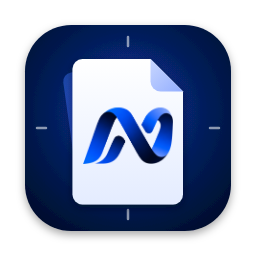
</p>

<h1 align="center">NOYA Files</h1>

<p align="center">
  <strong>A smarter home for your files.</strong><br>
  A free, open-source, native file manager for macOS, built with SwiftUI and AppKit.
</p>

<p align="center">
  <a href="https://github.com/elit28/NoyaFiles/releases/latest/download/NOYA-Files.dmg"></a>
</p>

<p align="center">
  <a href="https://github.com/elit28/NoyaFiles/actions/workflows/ci.yml"></a>
  
  
  <a href="LICENSE"></a>
</p>

<p align="center"><a href="README.md">Français</a> · <strong>English</strong></p>

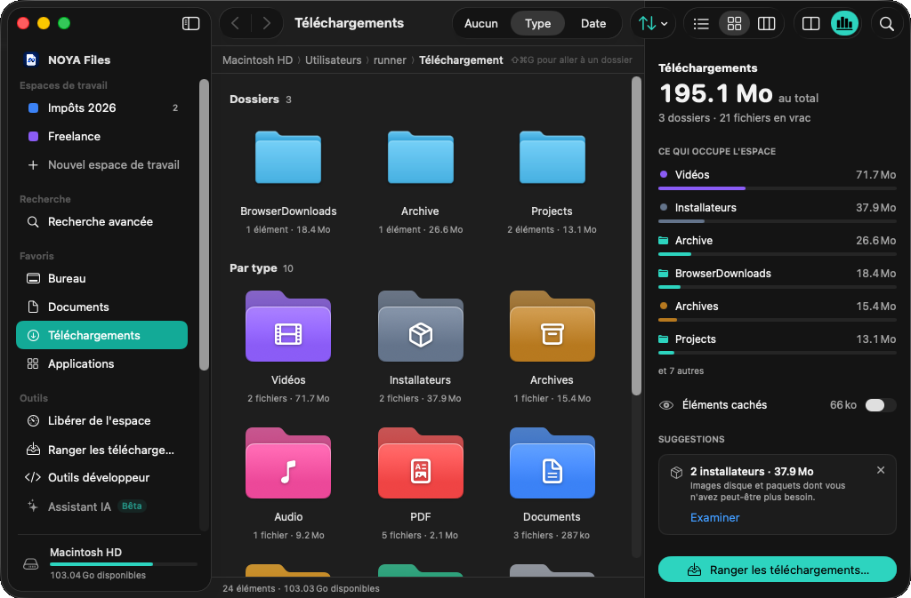

The screenshots show the French interface; the app is also fully available in English.

## Contents

- [Features](#features)
- [Installation](#installation)
- [Updates](#updates)
- [Privacy](#privacy)
- [FAQ](#faq)
- [For developers](#for-developers)
- [License and credits](#license-and-credits)

## Features

### Browse

- **Three views**: a grid grouped by kind or date, a detailed list, and columns.
- **The size of every folder**, measured in the background, and an **Insights panel** that shows what takes up space and suggests cleanups.
- **Quick Look** with the space bar, detailed file info, and Finder tags.
- **Dual pane** to copy (F5) or move (F6) between two folders, and to compare them.

### Organize

- **Workspaces and collections**: gather files by project without moving them. **Smart rules** add new matching files automatically.
- **Advanced search** in file names and document contents, with filters by kind, date, size and tag, and saved searches.
- **Tidy up Downloads** in one click, with a preview before anything moves and an undo.

### Free up space

- **Free Up Space**: big files you no longer open, developer caches, duplicates, installers of apps already installed, and the Trash. Nothing is deleted without confirmation.

### For developers

- **Developer tools**: your Git repositories with their branch, changes, last commit and cache sizes, a built-in terminal (⌃`), and opening in your editor.

### Optional AI assistant

- Ask in your own words: “Find my 2026 invoices and put them in the Taxes workspace”. The assistant finds the files, proposes clear names from their contents, and changes nothing without your agreement.
- Everything runs on your Mac, with Apple Intelligence on macOS 26 when available. Off by default.

### Truly Mac

- Light or dark theme, following the system or your choice, and an accent color.
- English and French interface.
- Finder keyboard shortcuts, drag and drop, and an “Open With” menu.
- Automatic updates, with nothing to do.

### Screenshots

| | |
| --- | --- |
| 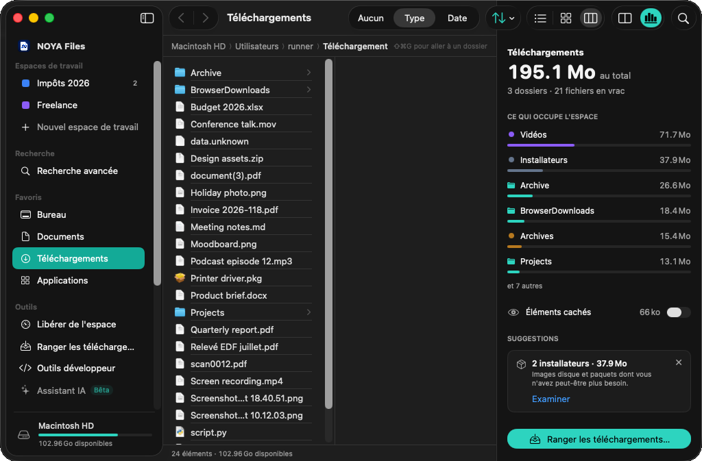 | 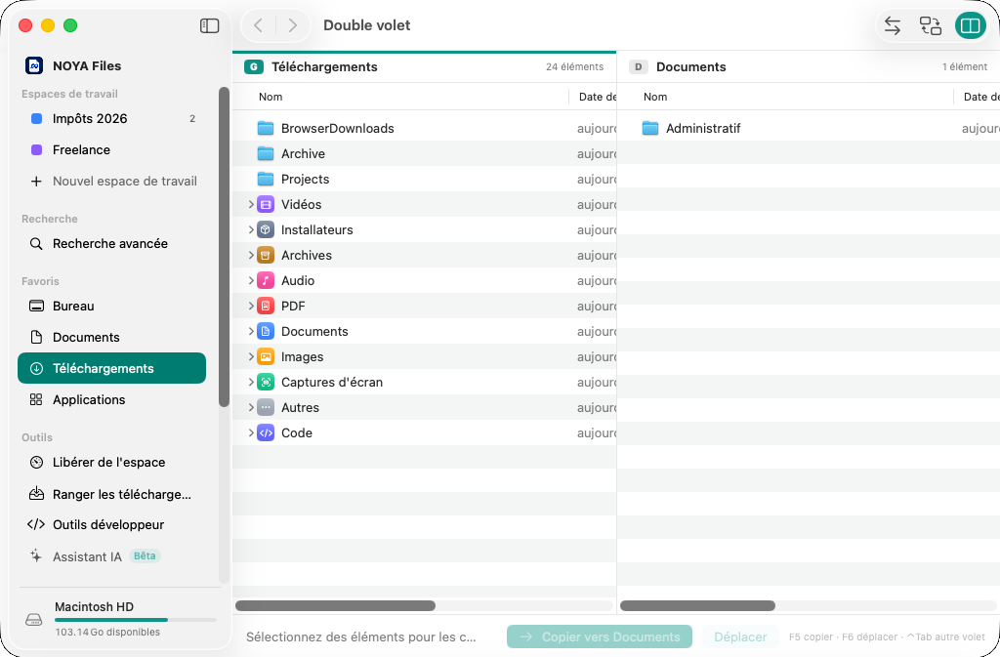 |
| Column view | Dual pane |
| 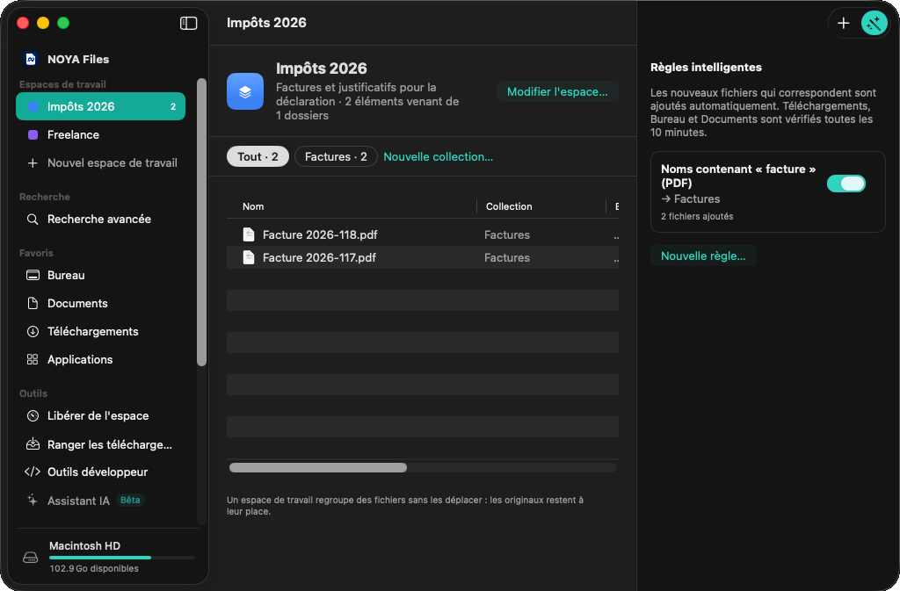 | 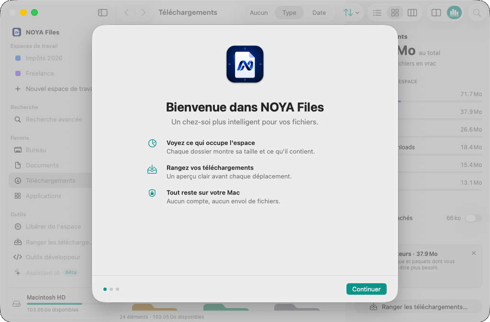 |
| Workspace with a smart rule | First launch |
| 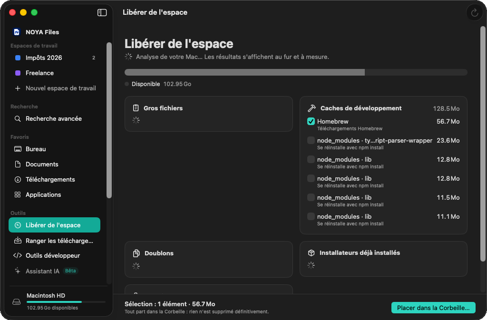 | 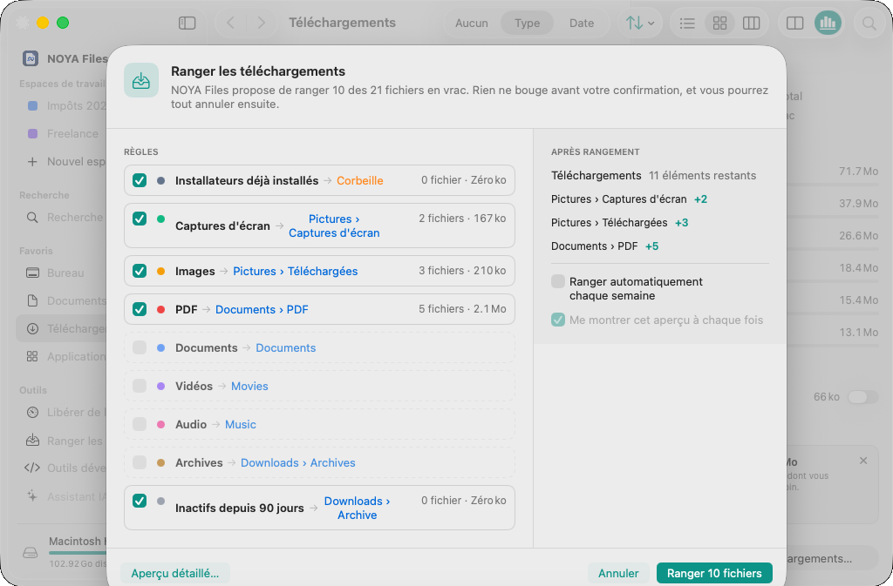 |
| Free Up Space | Tidy up Downloads |
| 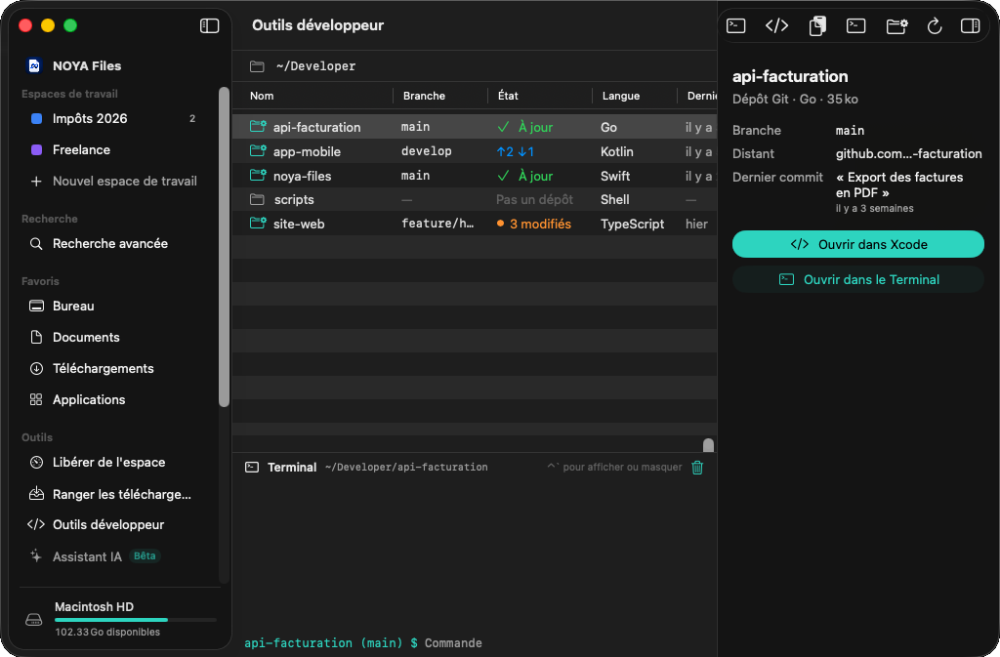 | 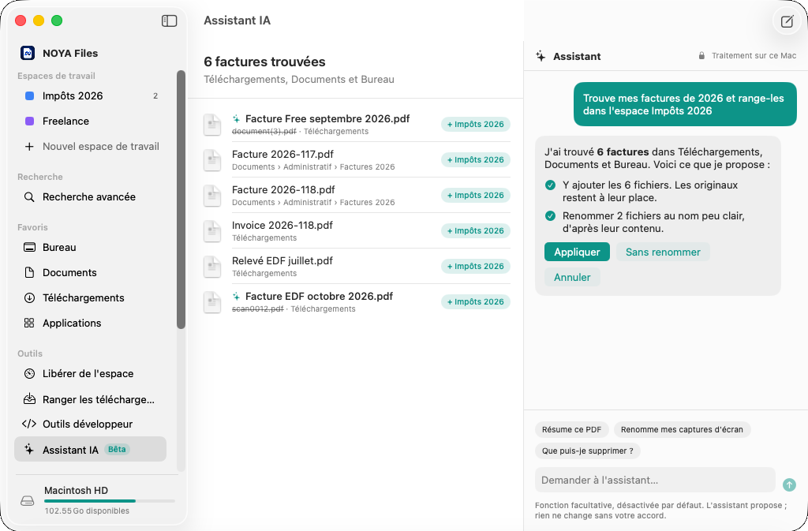 |
| Developer tools | AI assistant |

## Installation

You need **macOS 14 Sonoma or later**, on an Apple silicon or Intel Mac.

1. **[Download NOYA Files](https://github.com/elit28/NoyaFiles/releases/latest/download/NOYA-Files.dmg)**, always the latest version.
2. Open `NOYA-Files.dmg`, then drag **NOYA Files** onto the **Applications** folder.

   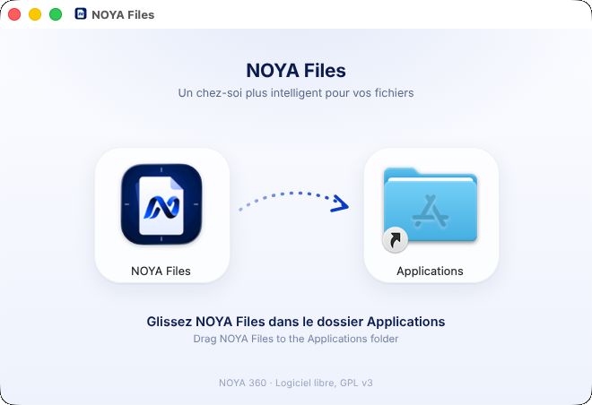

3. Open NOYA Files from the Applications folder.

**On first launch**, macOS says it cannot verify the app, because it is not signed by Apple yet. Click **Done**, open **System Settings › Privacy & Security**, scroll to the line “NOYA Files was blocked” and click **Open Anyway**. You only do this once.

The app then welcomes you in three steps: introduction, access to your files, and preferences.

Every version, with its notes, is on the [releases page](https://github.com/elit28/NoyaFiles/releases). The detailed history is in the [changelog](CHANGELOG.md) (in French).

### Uninstall

Drag NOYA Files from Applications to the Trash. To also remove your settings and workspaces, delete the `~/Library/Application Support/NOYA Files` folder and the `~/Library/Preferences/com.noya360.NoyaFiles.plist` file.

## Updates

Since version 0.2.2, NOYA Files updates itself. Once a day, it asks GitHub whether a new version exists, downloads it in the background, and installs it when you quit the app.

- To check right away: **NOYA Files › Check for Updates…**
- To be asked before each installation, or to turn updates off: **Settings › General › Updates**.

Every update is signed. The app refuses to install a file whose signature does not match the key built into it.

## Privacy

Everything happens on your Mac: no account, no analytics, no file ever sent over the internet.

- **Updates**: the app's only connection is the daily update check with GitHub, which sends nothing about your Mac or your files. You can turn it off.
- **AI assistant**: off by default. Once turned on, it handles your requests and files on the Mac, with Apple Intelligence when available.

## FAQ

<details>
<summary><strong>macOS says NOYA Files cannot be opened or verified</strong></summary>

This is expected on first launch, because the app is not signed by Apple yet. Follow the “On first launch” step in [Installation](#installation). If the app still does not open, start it from Terminal to see macOS's message, then [file a bug report](https://github.com/elit28/NoyaFiles/issues/new/choose) with it:

```bash
"/Applications/NOYA Files.app/Contents/MacOS/NOYA Files"
```
</details>

<details>
<summary><strong>I have version 0.2.0 or 0.2.1 and it does not start</strong></summary>

These two versions do not start on recent Macs. [Download the latest version](https://github.com/elit28/NoyaFiles/releases/latest/download/NOYA-Files.dmg) and replace the old one in Applications. Later versions install themselves.
</details>

<details>
<summary><strong>Why Full Disk Access?</strong></summary>

To measure all your folders and look inside the Trash. Without it, NOYA Files still works: macOS asks for permission folder by folder. You grant or remove it in System Settings › Privacy & Security › Full Disk Access.
</details>

<details>
<summary><strong>Does the AI assistant need the internet or an account?</strong></summary>

No. It runs on the Mac. With Apple Intelligence (macOS 26 or later, on a compatible Mac), it understands documents better; without it, it relies on simple rules. It stays off until you turn it on.
</details>

<details>
<summary><strong>Which version do I have?</strong></summary>

**NOYA Files › About NOYA Files**, or Settings › General › Updates.
</details>

<details>
<summary><strong>I found a bug or have an idea</strong></summary>

[Open an issue](https://github.com/elit28/NoyaFiles/issues/new/choose): a form guides you.
</details>

## For developers

```bash
git clone https://github.com/elit28/NoyaFiles.git
```

```bash
open NoyaFiles/NoyaFiles.xcodeproj
```

Choose the **NoyaFiles** scheme and run with ⌘R. You need Xcode 16 or later; with Xcode 26, the assistant can also use Apple Intelligence.

The developer documentation is in French:

| Document | Contents |
| --- | --- |
| [CONTRIBUTING.md](CONTRIBUTING.md) | Building, testing, translating, proposing a change |
| [docs/ARCHITECTURE.md](docs/ARCHITECTURE.md) | How the code is organized and how each part works |
| [docs/RELEASING.md](docs/RELEASING.md) | Publishing a version, signed updates, repository secrets |
| [docs/TESTING.md](docs/TESTING.md) | What CI checks, and the manual test list |
| [CHANGELOG.md](CHANGELOG.md) | What changes from one version to the next |
| [SECURITY.md](SECURITY.md) | Reporting a security issue |

Built with Swift 6, SwiftUI, AppKit and native macOS frameworks, plus [Sparkle](https://sparkle-project.org) for updates.

## License and credits

NOYA Files is free software, distributed under the [GNU General Public License, version 3 or any later version](LICENSE).

Developed by NOYA 360. NOYA Files is an independent project, not affiliated with FileOS or Apple.
