<p align="center">
  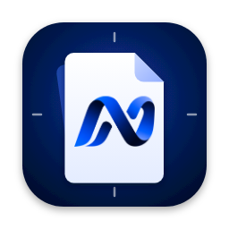
</p>

<h1 align="center">NOYA Files</h1>

<p align="center">
  <strong>Un chez-soi plus intelligent pour vos fichiers.</strong><br>
  Gestionnaire de fichiers libre et natif pour macOS, en SwiftUI et AppKit.
</p>

<p align="center">
  <a href="https://github.com/elit28/NoyaFiles/releases/latest/download/NOYA-Files.dmg"></a>
</p>

<p align="center">
  <a href="https://github.com/elit28/NoyaFiles/actions/workflows/ci.yml"></a>
  
  
  <a href="LICENSE"></a>
</p>

<p align="center"><strong>Français</strong> · <a href="README.en.md">English</a></p>

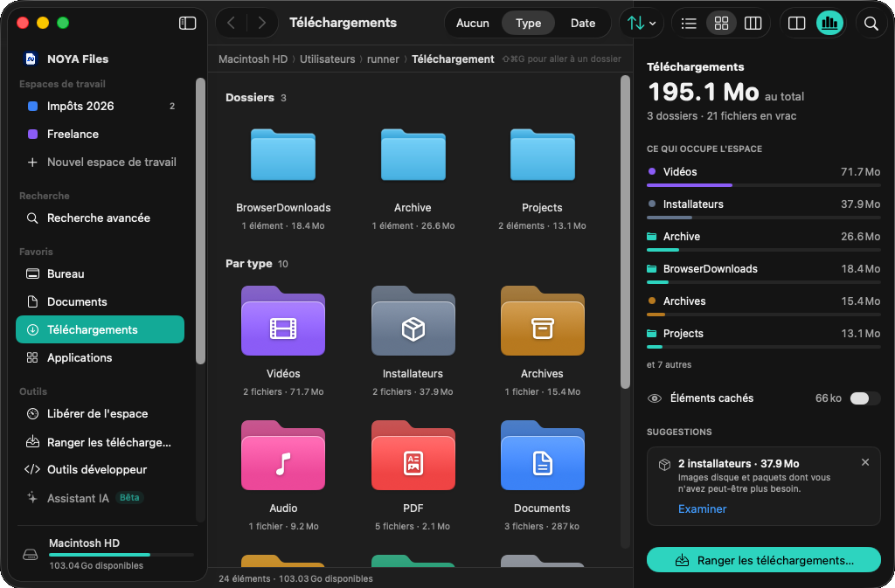

## Sommaire

- [Fonctionnalités](#fonctionnalités)
- [Installation](#installation)
- [Mises à jour](#mises-à-jour)
- [Confidentialité](#confidentialité)
- [Questions fréquentes](#questions-fréquentes)
- [Pour les développeurs](#pour-les-développeurs)
- [Licence et crédits](#licence-et-crédits)

## Fonctionnalités

### Parcourir

- **Trois présentations** : grille regroupée par type ou par date, liste détaillée, colonnes.
- **La taille de chaque dossier**, calculée en arrière-plan, et un **panneau Analyse** qui montre ce qui occupe l'espace et propose des nettoyages.
- **Coup d'œil** avec la barre d'espace, infos détaillées du fichier, tags du Finder.
- **Double volet** pour copier (F5) ou déplacer (F6) d'un dossier à l'autre, et comparer deux dossiers.

### Organiser

- **Espaces de travail et collections** : rassemblez des fichiers par projet sans les déplacer. Des **règles intelligentes** y ajoutent automatiquement les nouveaux fichiers qui correspondent.
- **Recherche avancée** dans les noms et le contenu des documents, avec filtres par type, date, taille et tag, et recherches enregistrées.
- **Ranger les téléchargements** en un clic, avec un aperçu avant chaque déplacement et une annulation possible.

### Faire de la place

- **Libérer de l'espace** : gros fichiers que vous n'ouvrez plus, caches de développement, doublons, installateurs d'apps déjà installées, Corbeille. Rien n'est supprimé sans confirmation.

### Pour les développeurs

- **Outils développeur** : vos dépôts Git avec leur branche, leurs modifications, le dernier commit et le poids des caches, un terminal intégré (⌃`) et l'ouverture dans votre éditeur.

### Assistant IA, facultatif

- Demandez avec vos mots : « Trouve mes factures de 2026 et range-les dans l'espace Impôts ». L'assistant trouve les fichiers, propose des noms clairs d'après leur contenu, et ne change rien sans votre accord.
- Tout se passe sur votre Mac, avec Apple Intelligence sous macOS 26 quand il est disponible. Désactivé par défaut.

### Vraiment Mac

- Thème clair ou sombre, selon le système ou à votre choix, et couleur d'accent.
- Interface en français et en anglais.
- Raccourcis clavier du Finder, glisser-déposer, menu « Ouvrir avec ».
- Mises à jour automatiques, sans rien avoir à faire.

### En images

| | |
| --- | --- |
| 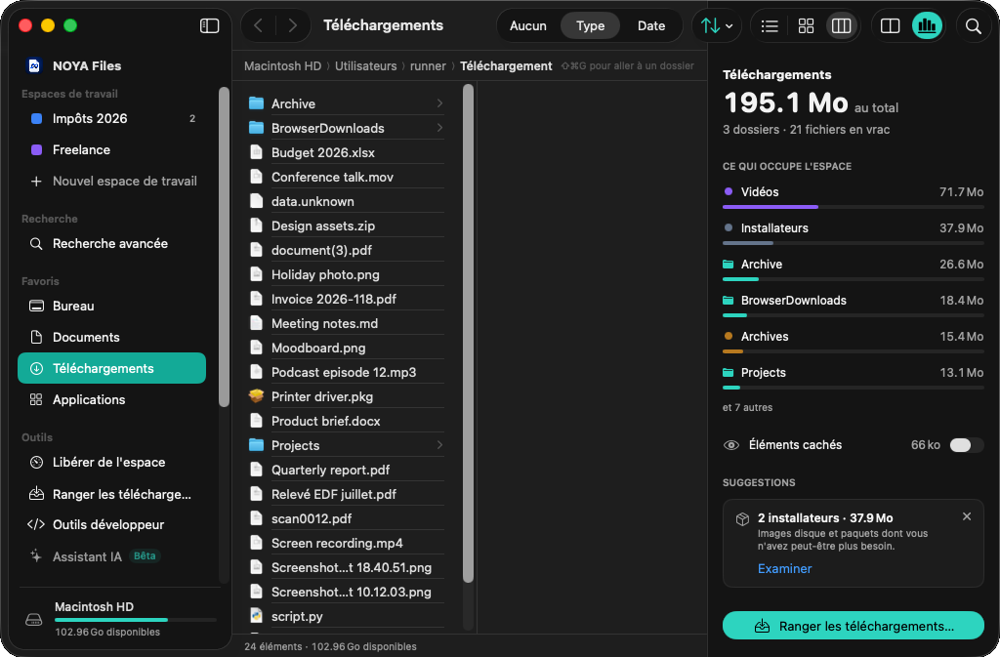 | 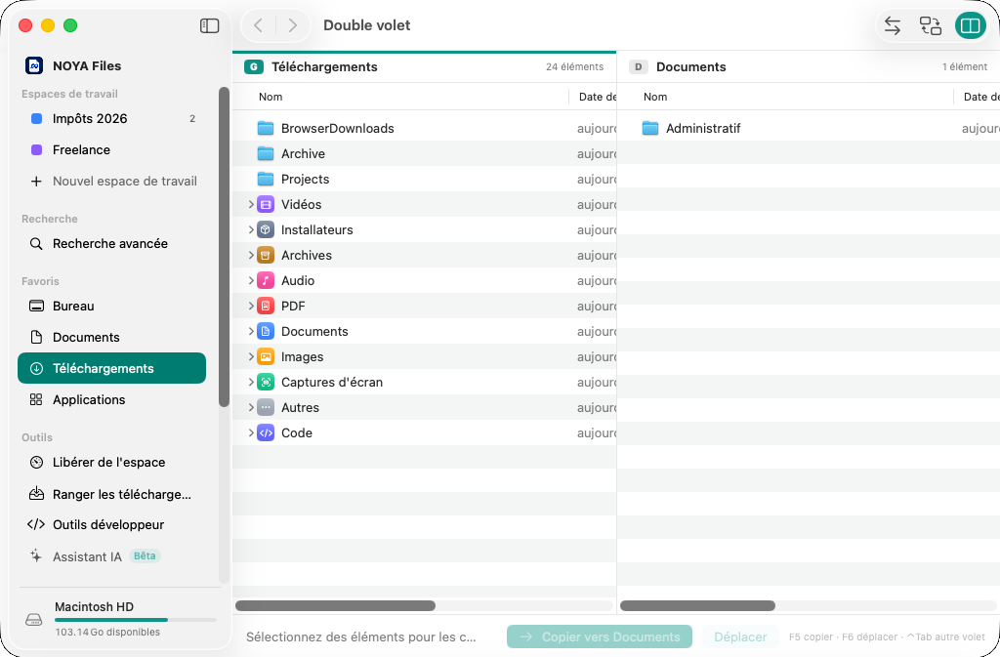 |
| Vue en colonnes | Double volet |
| 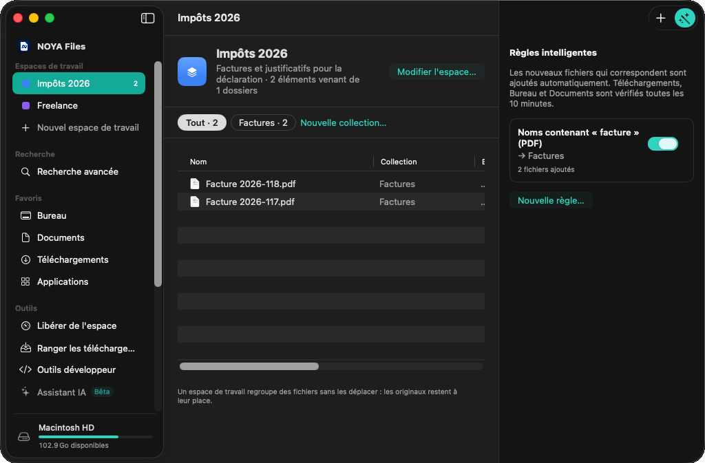 | 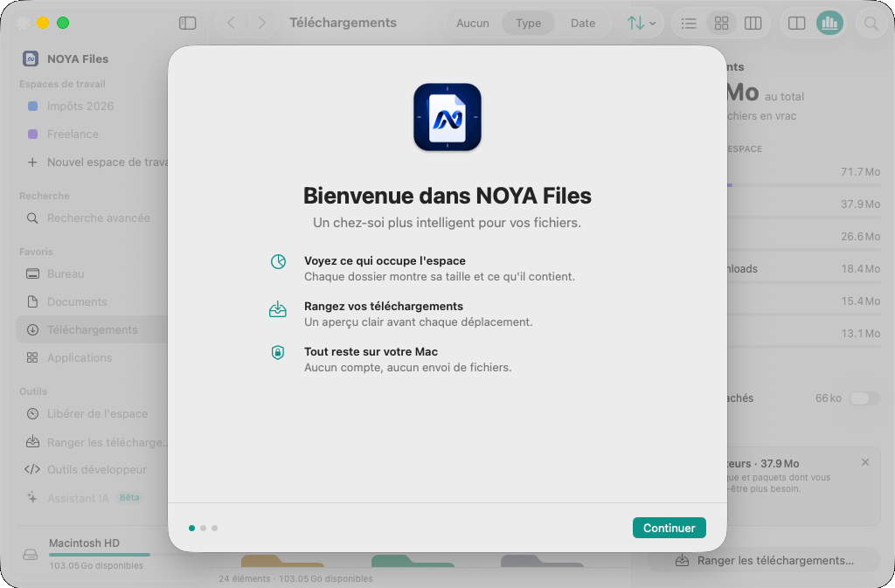 |
| Espace de travail avec règle intelligente | Premier lancement |
| 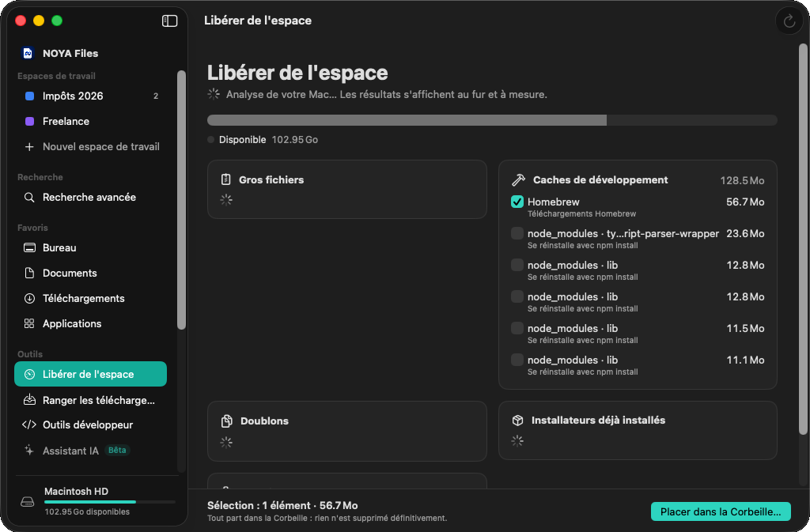 | 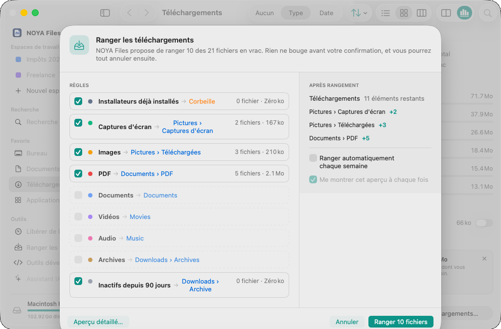 |
| Libérer de l'espace | Ranger les téléchargements |
| 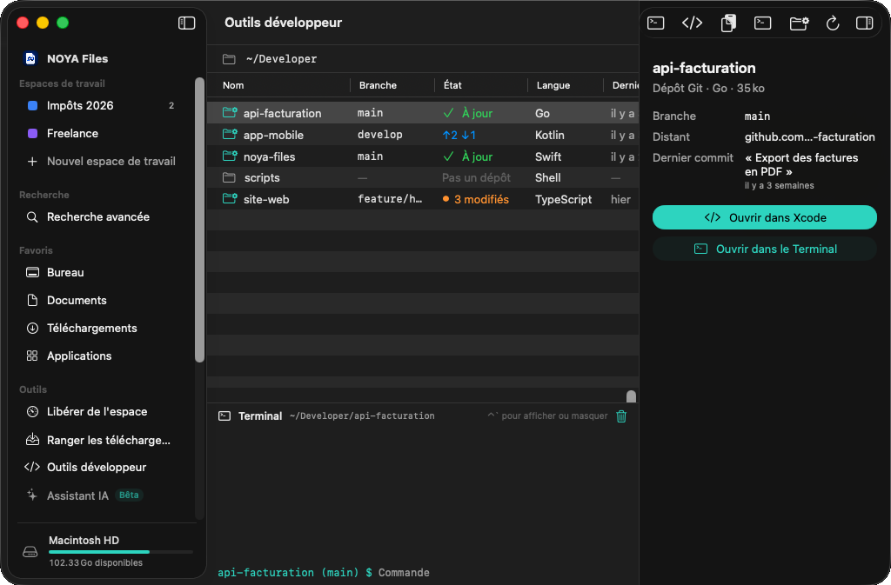 | 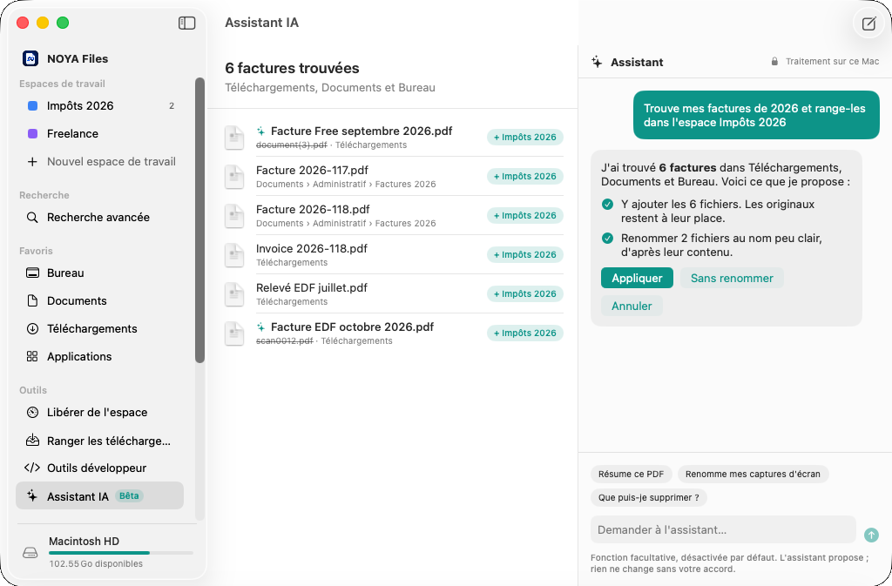 |
| Outils développeur | Assistant IA |

## Installation

Il vous faut **macOS 14 Sonoma ou plus récent**, sur un Mac Apple silicon ou Intel.

1. **[Téléchargez NOYA Files](https://github.com/elit28/NoyaFiles/releases/latest/download/NOYA-Files.dmg)**, toujours dans sa dernière version.
2. Ouvrez le fichier `NOYA-Files.dmg`, puis glissez **NOYA Files** sur le dossier **Applications**.

   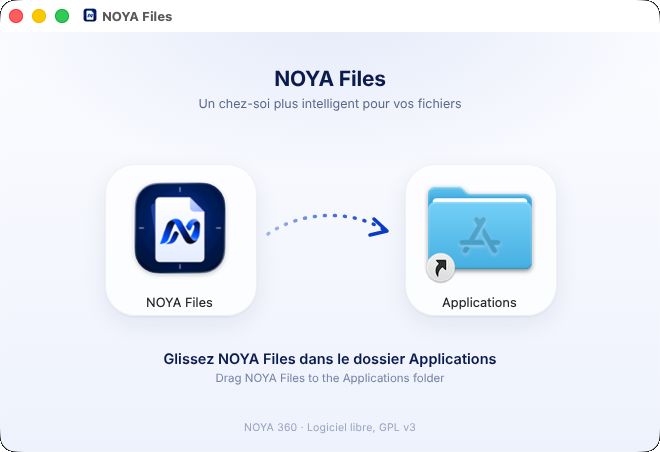

3. Ouvrez NOYA Files depuis le dossier Applications.

**Au premier lancement**, macOS indique qu'il ne peut pas vérifier l'app : elle n'est pas encore signée par Apple. Cliquez sur **Terminé**, ouvrez **Réglages Système › Confidentialité et sécurité**, descendez jusqu'à la ligne « NOYA Files a été bloqué » et cliquez sur **Ouvrir quand même**. C'est à faire une seule fois.

L'app vous accueille ensuite en trois étapes : présentation, accès à vos fichiers, préférences.

Toutes les versions, avec leurs notes, sont sur la [page des versions](https://github.com/elit28/NoyaFiles/releases). L'historique détaillé est dans le [journal des modifications](CHANGELOG.md).

### Désinstaller

Glissez NOYA Files d'Applications à la Corbeille. Pour effacer aussi vos réglages et vos espaces de travail, supprimez le dossier `~/Library/Application Support/NOYA Files` et le fichier `~/Library/Preferences/com.noya360.NoyaFiles.plist`.

## Mises à jour

Depuis la version 0.2.2, NOYA Files se met à jour toute seule. Une fois par jour, elle demande à GitHub si une nouvelle version existe, la télécharge en arrière-plan et l'installe quand vous quittez l'app.

- Pour vérifier tout de suite : menu **NOYA Files › Rechercher les mises à jour…**
- Pour être prévenu avant chaque installation, ou tout désactiver : **Réglages › Général › Mises à jour**.

Chaque mise à jour est signée. L'app refuse d'installer un fichier dont la signature ne correspond pas à la clé intégrée.

## Confidentialité

Tout se passe sur votre Mac : pas de compte, pas de statistiques, aucun fichier envoyé sur Internet.

- **Mises à jour** : la seule connexion de l'app est la vérification quotidienne des mises à jour auprès de GitHub, qui n'envoie rien sur votre Mac ni sur vos fichiers. Vous pouvez la désactiver.
- **Assistant IA** : désactivé par défaut. Une fois activé, il traite vos demandes et vos fichiers sur le Mac, avec Apple Intelligence quand il est disponible.

## Questions fréquentes

<details>
<summary><strong>macOS dit que NOYA Files ne peut pas être ouvert ou vérifié</strong></summary>

C'est normal au premier lancement : l'app n'est pas encore signée par Apple. Suivez l'étape « Au premier lancement » de la section [Installation](#installation). Si l'app refuse encore de s'ouvrir, lancez-la depuis le Terminal pour voir le message de macOS, puis [ouvrez un rapport de bug](https://github.com/elit28/NoyaFiles/issues/new/choose) avec ce message :

```bash
"/Applications/NOYA Files.app/Contents/MacOS/NOYA Files"
```
</details>

<details>
<summary><strong>J'ai la version 0.2.0 ou 0.2.1 et elle ne démarre pas</strong></summary>

Ces deux versions ne démarrent pas sur les Mac récents. [Téléchargez la dernière version](https://github.com/elit28/NoyaFiles/releases/latest/download/NOYA-Files.dmg) et remplacez l'ancienne dans Applications. Les suivantes s'installeront toutes seules.
</details>

<details>
<summary><strong>Pourquoi l'accès complet au disque ?</strong></summary>

Pour mesurer tous vos dossiers et regarder dans la Corbeille. Sans lui, NOYA Files fonctionne quand même : macOS demande l'autorisation dossier par dossier. L'accès se donne ou se retire dans Réglages Système › Confidentialité et sécurité › Accès complet au disque.
</details>

<details>
<summary><strong>L'assistant IA a-t-il besoin d'Internet ou d'un compte ?</strong></summary>

Non. Il fonctionne sur le Mac. Avec Apple Intelligence (macOS 26 ou plus récent, sur un Mac compatible), il comprend mieux les documents ; sans, il utilise des règles simples. Il est désactivé tant que vous ne l'activez pas.
</details>

<details>
<summary><strong>Comment savoir quelle version j'ai ?</strong></summary>

Menu **NOYA Files › À propos de NOYA Files**, ou Réglages › Général › Mises à jour.
</details>

<details>
<summary><strong>J'ai trouvé un bug ou j'ai une idée</strong></summary>

[Ouvrez une issue](https://github.com/elit28/NoyaFiles/issues/new/choose) : un formulaire vous guide.
</details>

## Pour les développeurs

```bash
git clone https://github.com/elit28/NoyaFiles.git
```

```bash
open NoyaFiles/NoyaFiles.xcodeproj
```

Choisissez le schéma **NoyaFiles** et lancez avec ⌘R. Il faut Xcode 16 ou plus récent ; avec Xcode 26, l'assistant peut aussi utiliser Apple Intelligence.

| Document | Contenu |
| --- | --- |
| [CONTRIBUTING.md](CONTRIBUTING.md) | Compiler, tester, traduire, proposer une modification |
| [docs/ARCHITECTURE.md](docs/ARCHITECTURE.md) | Organisation du code et fonctionnement de chaque partie |
| [docs/RELEASING.md](docs/RELEASING.md) | Publier une version, mises à jour signées, secrets du dépôt |
| [docs/TESTING.md](docs/TESTING.md) | Ce que la CI vérifie, et la liste des essais à la main |
| [CHANGELOG.md](CHANGELOG.md) | Ce qui change d'une version à l'autre |
| [SECURITY.md](SECURITY.md) | Signaler une faille de sécurité |

Construit avec Swift 6, SwiftUI, AppKit et les frameworks natifs de macOS, plus [Sparkle](https://sparkle-project.org) pour les mises à jour.

## Licence et crédits

NOYA Files est un logiciel libre, distribué sous la [licence publique générale GNU, version 3 ou toute version ultérieure](LICENSE).

Développé par NOYA 360. NOYA Files est un projet indépendant, sans lien avec FileOS ni avec Apple.
